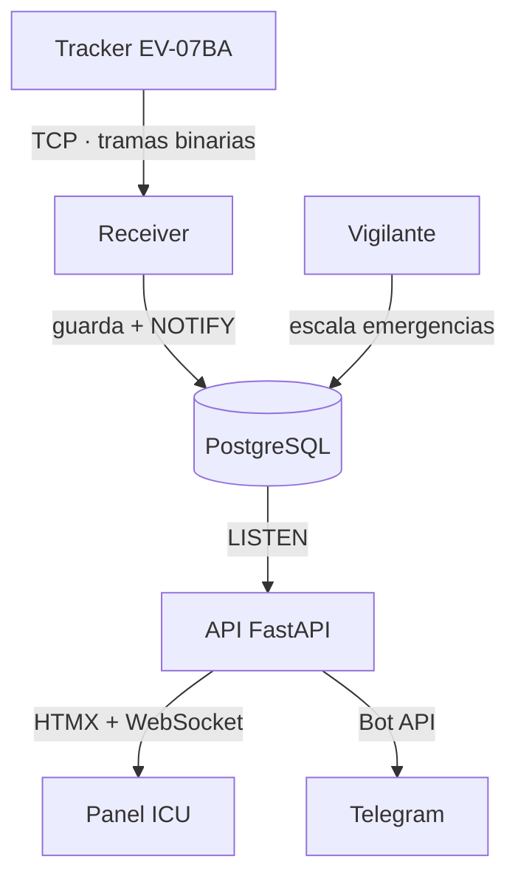

# ICU TrackerLife · Detección de caídas en tiempo real

Detección de caídas de pacientes en tiempo real con trackers GPS · FastAPI · PostgreSQL · WebSocket · Docker

Proyecto en equipo · Hackatón 2026 · ISFT N° 177
El código fuente está en un repositorio privado. Disponible para revisión a pedido.

---

## Qué problema resuelve
Un tracker GPS personal (EV-07BA) detecta una caída. El sistema confirma que la
persona sigue en el piso y avisa al hospital más cercano, que gestiona la
emergencia desde un panel web. Si nadie responde, escala el aviso a familiares
y a otros hospitales.

## Mi rol
- Reorganicé la estructura del proyecto y unifiqué el entorno en un solo
  `docker-compose` para desarrollo y VPS, usando perfiles de Docker Compose.
- Consolidé el sistema en una única base de datos y una única interfaz,
  reemplazando el dashboard React por un panel server-side con HTMX.
- Agregué al receptor TCP un margen de movimiento configurable tras una caída,
  para evitar que el propio equipo descartara su caída (falsos negativos).
- Desarrollé el mapa de emergencias con la ubicación del paciente y de los
  hospitales cercanos, y el mapa de equipos como vista principal del panel.
- Desarrollé el panel de pacientes y la guía de uso integrada.
- Revisé e integré los pull requests del equipo.

## Stack
Python 3.12 · FastAPI · SQLAlchemy 2.0 · PostgreSQL 16 · WebSocket · HTMX · Jinja2 ·
JWT · bcrypt · Telegram Bot API · Docker Compose · pytest

## Arquitectura

## Decisiones técnicas
- **PostgreSQL LISTEN/NOTIFY como bus de mensajes:** los procesos se coordinan
  a través de la base, sin sumar Redis ni RabbitMQ al stack.
- **Códec propio del protocolo binario Eview:** el tracker no habla HTTP; las
  tramas se decodifican sin dependencias externas.
- **Ventana de confirmación de caída:** antes de alertar, el sistema espera y
  verifica que no haya movimiento, para reducir falsas alarmas.
- **Permisos por rol:** cada usuario recibe por WebSocket solo los eventos de
  los dispositivos que tiene permitido ver.